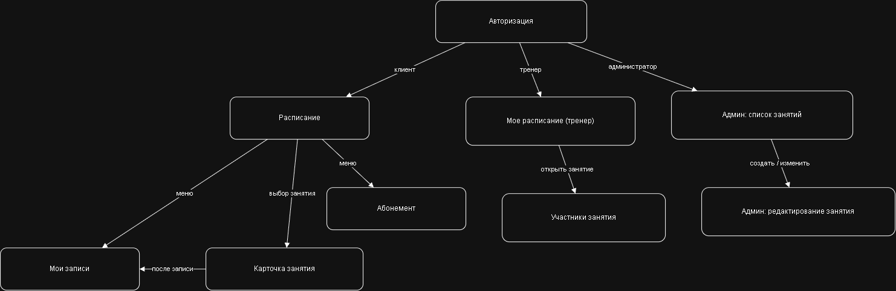
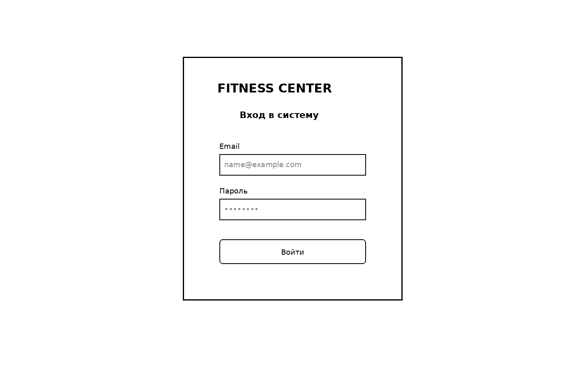
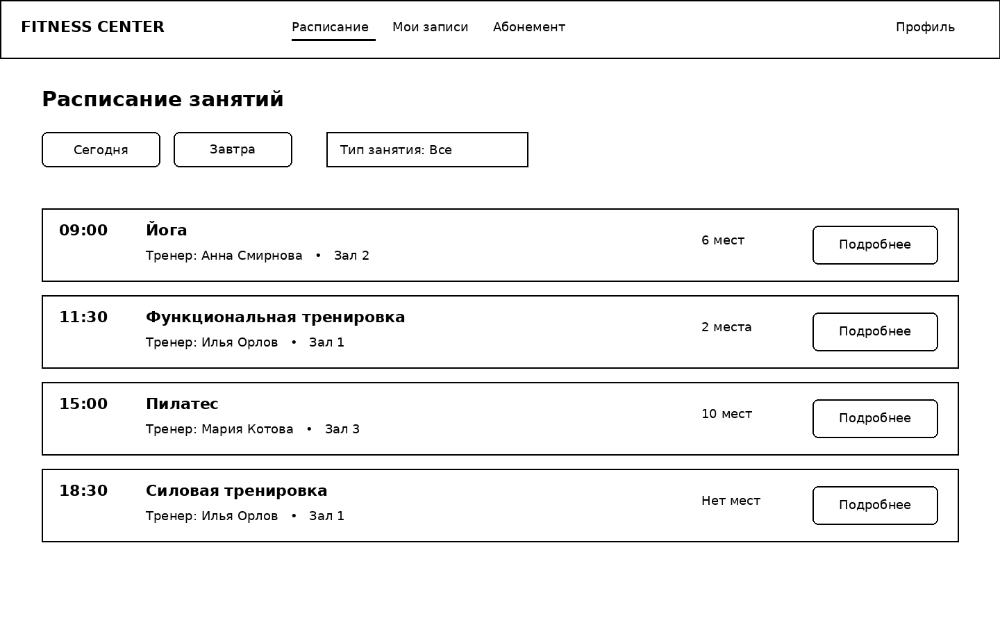
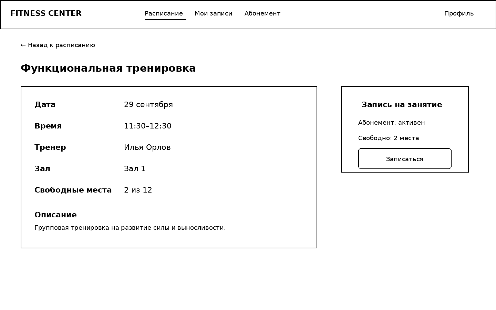
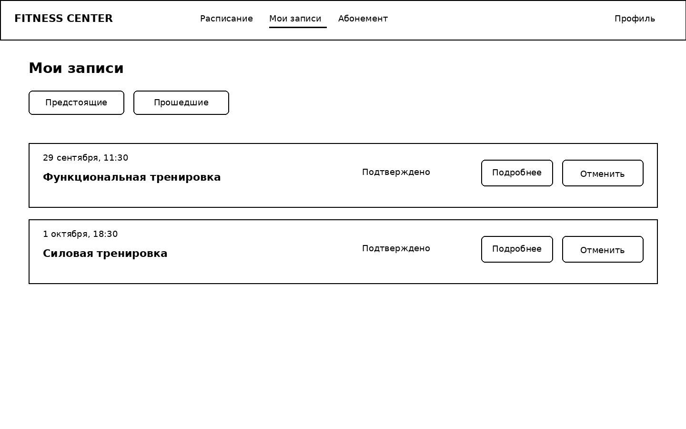
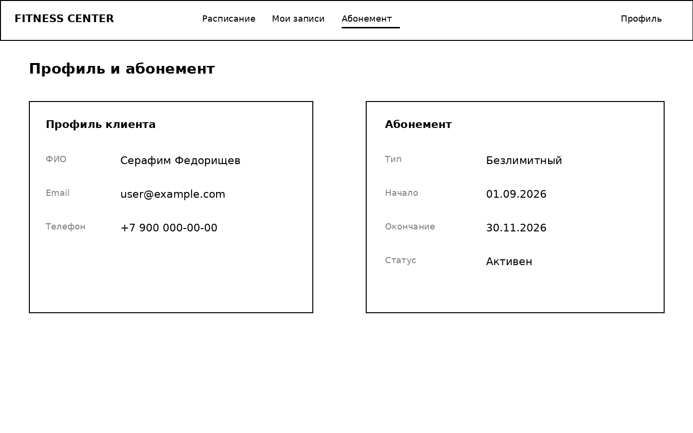
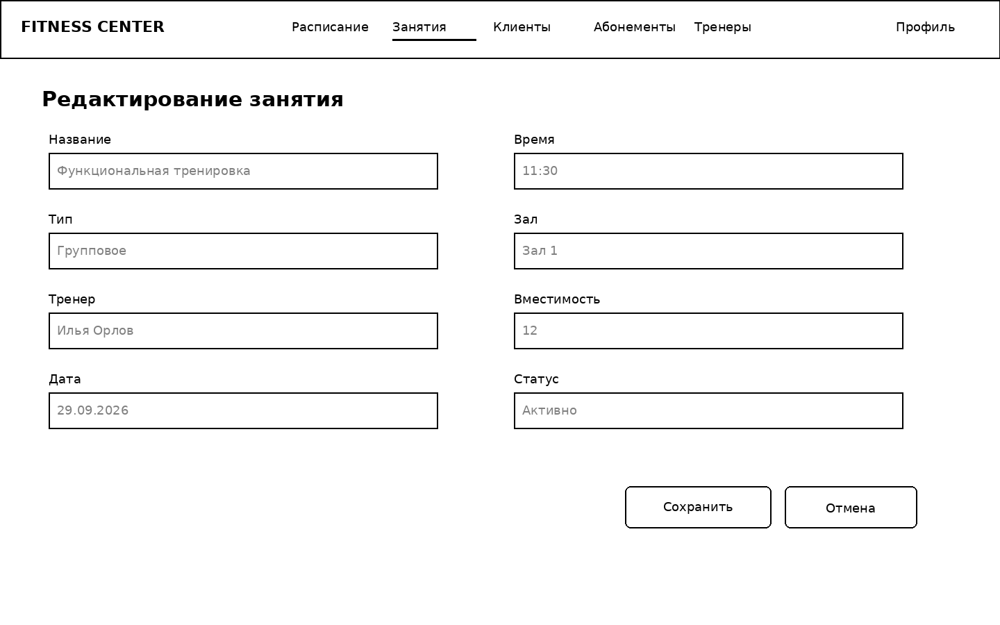

# Лабораторная работа №4

## Проектирование пользовательского интерфейса

### Вариант 20. Система учета клиентов фитнес-центра

## Цель работы

Разработать структуру пользовательского интерфейса информационной системы фитнес-центра, определить перечень основных экранов, спроектировать навигацию между ними и подготовить wireframe-прототипы ключевых страниц с учетом ролей пользователей и сценариев, определенных в предыдущих лабораторных работах.

## 1. Структура пользовательского интерфейса

Интерфейс проектируется для трех основных ролей:

- **Клиент** — просматривает расписание, записывается на занятия, управляет своими записями и просматривает абонемент.
- **Тренер** — просматривает собственное расписание и списки участников занятий.
- **Администратор** — управляет занятиями, расписанием, клиентами и абонементами.

### Перечень основных экранов

| № | Экран | Назначение | Основные элементы | Доступные действия |
|---|---|---|---|---|
| 1 | Авторизация | Вход пользователя | email, пароль, кнопка входа | войти |
| 2 | Расписание | Просмотр доступных занятий | навигация, фильтры, список занятий | открыть занятие |
| 3 | Карточка занятия | Подробная информация о тренировке | дата, время, тренер, зал, места, описание | записаться / отменить запись |
| 4 | Мои записи | Просмотр записей клиента | список тренировок, статусы | открыть / отменить |
| 5 | Абонемент / Профиль | Просмотр личных данных и абонемента | ФИО, контакты, тип и срок действия | просмотреть |
| 6 | Редактирование занятия | Управление занятием администратором | форма с параметрами занятия | сохранить / отменить |

Дополнительно для тренера предусмотрен экран «Мое расписание» со списком назначенных занятий и переходом к списку участников.

## 2. Организация интерфейса

Основные принципы:

- единый стиль и расположение навигации;
- минимальное количество действий для ключевых сценариев;
- явное отображение свободных мест и статусов;
- различный набор функций для разных ролей;
- повторное использование одинаковых UI-компонентов;
- понятные подписи действий.

### Навигация клиента

- Расписание
- Мои записи
- Абонемент
- Профиль / выход

### Навигация тренера

- Мое расписание
- Занятия
- Профиль / выход

### Навигация администратора

- Расписание
- Занятия
- Клиенты
- Абонементы
- Тренеры
- Профиль / выход

## 3. Навигация между экранами

Основной клиентский сценарий:

1. Пользователь открывает страницу авторизации.
2. После входа попадает на экран расписания.
3. Из расписания открывает карточку занятия.
4. В карточке может записаться на тренировку.
5. После записи переходит в «Мои записи».
6. Из «Моих записей» можно открыть занятие или отменить запись.
7. Раздел «Абонемент» доступен из верхнего меню.

Для тренера после входа открывается его расписание, откуда можно перейти к списку участников конкретного занятия.

Администратор после входа получает доступ к списку занятий и может перейти к экрану создания/редактирования занятия.

Файлы схемы навигации:

- `diagrams/navigation.drawio`
- `images/navigation.png`

## 4. Wireframe-прототипы основных экранов

Подготовлены low-fidelity wireframe-прототипы без детальной стилизации.

### 4.1. Авторизация

Основные элементы: название системы, email, пароль, кнопка «Войти».

### 4.2. Расписание

Основные элементы: верхняя навигация, выбор даты, фильтр типа занятия, список занятий, время, тренер, зал, свободные места, кнопка «Подробнее».

### 4.3. Карточка занятия

Основные элементы: название, дата, время, тренер, зал, количество свободных мест, описание и кнопка «Записаться».

### 4.4. Мои записи

Основные элементы: вкладки будущих и прошедших занятий, список записей, статус, кнопки «Подробнее» и «Отменить».

### 4.5. Абонемент / Профиль

Основные элементы: данные клиента и карточка текущего абонемента.

### 4.6. Редактирование занятия

Основные элементы: название, тип, тренер, дата, время, зал, вместимость, статус, кнопки «Сохранить» и «Отмена».

## 5. Принятые UX/UI-решения

### Расписание как центральный экран

Главная задача клиента — найти подходящее занятие и записаться на него, поэтому после входа пользователь сразу попадает в расписание.

### Минимизация переходов

Из расписания можно сразу открыть занятие, а в карточке находится основное действие — запись. Отдельный мастер не требуется.

### Постоянный доступ к «Моим записям»

Раздел вынесен в основную навигацию, чтобы пользователь мог быстро проверить будущие тренировки и отменить запись.

### Явное отображение абонемента

Статус и срок действия абонемента отображаются отдельно, чтобы пользователь заранее понимал, доступна ли ему запись на занятия.

### Разделение по ролям

Клиент не видит административные функции, тренер получает доступ только к своим занятиям, администратор — к управлению системой.

### Безопасное редактирование

Административная форма имеет отдельные действия «Сохранить» и «Отмена», чтобы уменьшить риск случайного изменения данных.

## 6. Файлы прототипов

- `design/wireframes.md`
- `images/01-login.png`
- `images/02-schedule.png`
- `images/03-class-details.png`
- `images/04-my-bookings.png`
- `images/05-membership.png`
- `images/06-admin-class-edit.png`
- `diagrams/navigation.drawio`
- `images/navigation.png`

## Вывод

В лабораторной работе была разработана структура пользовательского интерфейса информационной системы фитнес-центра. Определены основные экраны, спроектирована навигация и подготовлены wireframe-прототипы ключевых страниц.

Интерфейс ориентирован на основные сценарии: просмотр расписания, выбор занятия, запись на тренировку, управление собственными записями и просмотр абонемента. Для администратора предусмотрен отдельный экран редактирования занятия, а для тренера — доступ к собственному расписанию.

Подготовленные прототипы могут использоваться как основа для дальнейшей визуальной проработки и реализации Frontend.
